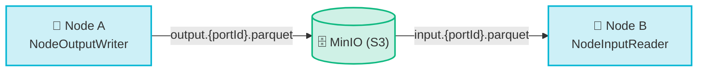

# Data Format

<Lead>

All data passed between workflow nodes is **Apache Parquet** (Snappy-compressed, Avro schema `DataRow`) — not JSON. This keeps data columnar, compressed, and query-ready from the moment it leaves a node.

</Lead>

<Badges>
  <Badge color="green">Apache Parquet</Badge>
  <Badge color="amber">Snappy</Badge>
  <Badge color="purple">Avro schema DataRow</Badge>
</Badges>

<CardGrid cols={2}>
  <Card icon="✍️" title="Writing" color="purple">
    `NodeOutputWriter.OutputPortWriter` writes rows to the node's output port(s).
  </Card>
  <Card icon="📖" title="Reading" color="cyan">
    `NodeInputReader` reads rows from each connected input port.
  </Card>
  <Card icon="🏷️" title="File names" color="pink">
    Output files are named `output.{portId}.parquet`; input files `input.{portId}.parquet`.
  </Card>
  <Card icon="🗂️" title="Staging" color="green">
    Files are staged in a local cache path before upload to (or after download from) MinIO, the platform's S3-compatible object store.
  </Card>
</CardGrid>

:::tip[Mix and match workers]
Because every node reads and writes the same Parquet/Avro format regardless of which worker or language implements it, nodes written in different feature repos — base analytics, cheminformatics, AI/ML — can be freely wired together in the same workflow graph.
:::
