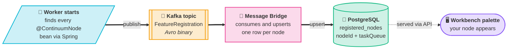

# Node Model & Feature Registration

Every workflow node is defined inside a **feature worker** — an independent service (e.g. `continuum-feature-base`, `continuum-feature-ai`, `continuum-feature-cheminformatics`, or your own) built with the `continuum-worker-springboot-starter`. Workers register their nodes centrally so the orchestration service knows which worker to dispatch each node to.

## Defining a node

Every node:

<Steps>

1. Is annotated `@ContinuumNode` (not just `@Component`) — enforced at build time by a Gradle validation task and at startup by the node activity handler.
2. Extends `ProcessNodeModel` (data nodes) or `TriggerNodeModel` (source nodes).
3. Overrides `inputPorts`, `outputPorts`, and `metadata` (as `ContinuumWorkflowModel.NodeData`).
4. Implements `execute()` — the simple overload for most nodes, or the `ExecutionContext` overload for nodes that need credentials.

</Steps>

```kotlin title="MyNodeModel.kt"
@ContinuumNode
class MyNodeModel : ProcessNodeModel() {
    override val inputPorts = mapOf("input" to ContinuumWorkflowModel.NodePort(...))
    override val outputPorts = mapOf("output" to ContinuumWorkflowModel.NodePort(...))
    override val metadata = ContinuumWorkflowModel.NodeData(...)

    override fun execute(
        properties: Map<String, Any>?,
        inputs: Map<String, NodeInputReader>,
        nodeOutputWriter: NodeOutputWriter,
        nodeProgressCallback: NodeProgressCallback,
        executionContext: ExecutionContext   // only needed for credential access
    ) { /* ... */ }
}
```

Node documentation is auto-loaded from `resources/<package>/<ClassName>.doc.md` on startup.

## How a node ends up in the registry

At startup, each worker publishes its available nodes to Kafka so the platform can build a central registry of "which node lives on which worker":



<Steps>

1. On `ApplicationReadyEvent`, the worker iterates every `ContinuumNodeModel` bean it has.
2. For each node, it builds a `FeatureRegistrationRequest` — containing `nodeId` (fully-qualified class name), `workerId`, `featureId`, `taskQueue`, a JSON `nodeManifest` (ports, schemas, title, icon), and the node's documentation markdown — and publishes it to Kafka (Avro, keyed by `nodeId`).
3. `continuum-message-bridge` consumes the message and performs an atomic upsert into the `registered_nodes` table.
4. The orchestration service's `InitializeActivity` later queries this registry (via the API server) to resolve which task queue should run each node in a workflow.

</Steps>

`featureId` is derived by stripping the trailing `.node` package segment from the class name, e.g. `org.projectcontinuum.feature.analytics.node.CreateTableNodeModel` → `org.projectcontinuum.feature.analytics`.

`nodeManifest` is kept as an opaque JSON string (not typed Avro fields) so the schema stays forward-compatible as `NodeData` evolves. Registration is one message per node, enabling clean idempotent upserts, and `extensions` (a `map<string>`) is reserved for future fields without breaking schema compatibility.

## Credentials

Nodes that need external secrets (API keys, DB passwords) don't receive them automatically:

- The node's `propertiesUISchema` declares a control with `options.format = "credential"` purely so `continuum-workbench` renders a credential picker in its config dialog — the backend doesn't read this schema.
- Inside `execute()`, the node reads its own `properties` to find the configured credential name, then calls `executionContext.getCredential<T>(name)`. This fetches the credential on demand from `continuum-credentials-server` (`GET /api/v1/credentials/{name}`) and deserializes it into `T`, throwing if not found.

:::info[Credentials are never stored in the workflow]
Credentials are fetched lazily, per execution — never bundled into the workflow definition or passed through Kafka.
:::
