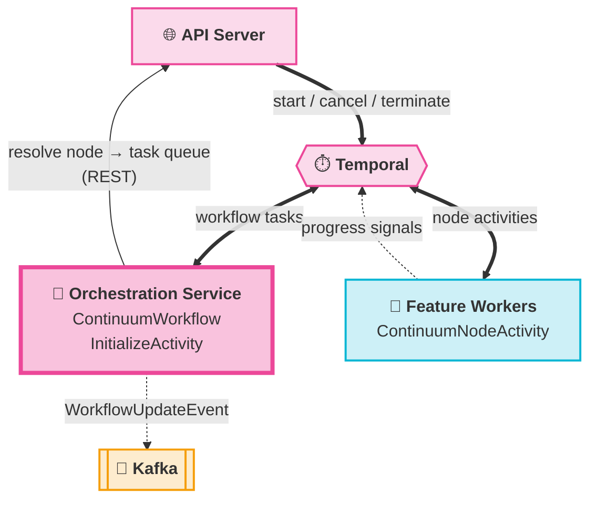
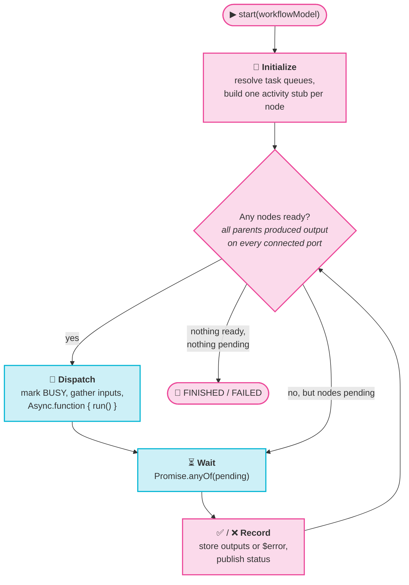

# Orchestration Service

<Lead>

`continuum-orchestration-service` is the interpreter at the heart of the platform. It takes the graph you drew on the canvas — plain JSON nodes and edges — and executes it as a real, durable Temporal workflow: deciding what runs when, routing each node to the right worker, wiring outputs to inputs, and reporting every state change back to the browser.

</Lead>

<Badges>
  <Badge color="pink">Temporal workflow worker</Badge>
  <Badge color="purple">DAG interpreter</Badge>
  <Badge color="amber">Kafka status publisher</Badge>
</Badges>

It is a standalone Spring Boot service (image `projectcontinuum/continuum-orchestration-service`) that registers two things with Temporal:

| Component | Task queue | Role |
|-----------|------------|------|
| `ContinuumWorkflow` | `WORKFLOW_TASK_QUEUE` | The workflow implementation — interprets the graph and drives the execution loop |
| `InitializeActivity` | `ACTIVITY_TASK_QUEUE_INITIALIZE` | Resolves which worker task queue runs each node type, via the API server's node registry |

:::info[It never runs node logic]
The orchestration service only *schedules* nodes. Every node's `execute()` runs inside a feature worker, as a Temporal activity. The orchestrator handles control flow and passes data *references* between nodes; the Parquet data itself goes straight between workers and MinIO.
:::

## Where it sits

The API server, workers and orchestrator never call each other to execute nodes. They all communicate through Temporal, which is why a crashed worker or orchestrator pod loses no progress.

## From graph to Temporal workflow

When the API server starts a `ContinuumWorkflow` with the workflow model (`ContinuumWorkflowModel`: nodes, edges, node properties), the orchestrator interprets it in four phases.

<Steps>

1. **Initialize.** `WorkflowActivityInitializer` collects the unique node types (the `NodeData.id` class names) and calls `InitializeActivity.getNodeTaskQueue()`. That activity calls `POST /api/v1/node-explorer/nodes/task-queues` on the API server. If any node type has no registered worker yet, the activity fails and Temporal retries it, so a workflow can be started before its workers come up. The orchestrator then builds a separate `IContinuumNodeActivity` stub for **each node instance**, routed to that node's task queue and carrying its own retry policy.
2. **Find ready nodes.** A node is ready when every parent has completed and produced output on every port this node is connected to, all of its input ports are wired, and it hasn't run or started yet. A node with an unconnected input port is marked `SKIPPED`.
3. **Dispatch in parallel.** For each ready node, the orchestrator maps each incoming edge's `sourceHandle` output to the node's `targetHandle` input, marks the node `BUSY` (animating its incoming edges on the canvas), and starts `IContinuumNodeActivity.run(node, inputs)` with `Async.function {}`. Independent branches of the DAG run concurrently.
4. **Wait and record.** `Promise.anyOf()` waits for whichever pending node finishes first. If the outputs contain the `$error` system port, the node is marked `FAILED` and recorded in the error map. Otherwise it is marked `SUCCESS` and its outputs become available to downstream nodes. The loop goes back to step 2 until no nodes are ready and none are pending.

</Steps>

:::tip[Data passes by reference]
A node's output `PortData` carries a remote reference to its Parquet file in MinIO, not the rows themselves. The orchestrator passes that reference to downstream nodes as their input, so Temporal history stays small no matter how much data a node produces. See [Data Format](./data-format.md).
:::

## Failure, retries & cancellation

| Situation | What the orchestrator does |
|-----------|----------------------------|
| A node activity throws, times out, or exhausts its retries | Converts the `ActivityFailure` into a `$error` output for that node only. Independent branches keep running; descendants of the failed node simply never become ready. |
| One or more nodes failed by the end | Publishes `FAILED` and ends the workflow with a non-retryable `ApplicationFailure` (`WorkflowExecutionFailed`) carrying `nodeErrors` and the successful `nodeToOutputsMap`. |
| User cancels | The API server first sends the `notifyCancelling` signal, which pins the status to `CANCELLED`, then issues Temporal `cancel()`. Nodes that are still `BUSY` are marked `CANCELLED` and a final event is published. |
| User terminates | The API server sends the `notifyTerminating` signal, which pins the status to `TERMINATED` and updates the search attribute, then issues Temporal `terminate()`. Workflow code can't run after a terminate, so the signal is the orchestrator's last chance to report. |

Default activity options per node stub:

- `startToCloseTimeout`: **60 days** (long-running nodes are expected)
- `heartbeatTimeout`: **5 minutes** (workers heartbeat in the background, every 60 s by default)
- Retry: exponential backoff (coefficient 2.0, max interval 100 s), up to **500 attempts**

A node can override any of these retry fields through `NodeData.retryOptions` (`initialIntervalSeconds`, `backoffCoefficient`, `maximumIntervalSeconds`, `maximumAttempts`, `doNotRetry`). Fields it doesn't set fall back to the defaults.

## Live status

The orchestrator is the **only** source of execution status events. Whenever a node starts, completes or reports progress, it publishes a `WorkflowUpdateEvent` to the Kafka topic `continuum-core-event-WorkflowExecutionSnapshot`, keyed by workflow ID. The event contains the full workflow model (node statuses, animated edges), every node's outputs and errors, overall progress (completed nodes ÷ total nodes), owner, and schedule ID. `continuum-message-bridge` consumes this topic, forwards each event to MQTT for the browser, and syncs it to the database.

Workers report fine-grained progress by sending the `updateNodeProgressSignal` signal to the running workflow. The orchestrator stores the progress on the node and publishes a fresh event.

The orchestrator also maintains two Temporal search attributes on every run, which the API server uses to list and filter executions:

- `Continuum:ExecutionStatus` (Int) — started / completed / failed / cancelled / terminated
- `Continuum:WorkflowFileName` (Keyword) — the workflow file the run came from

The `temporal-search-attributes-init` service in the local compose stack creates both attributes before the orchestrator starts.

## Determinism rules

`ContinuumWorkflow` is Temporal workflow code, so after a crash it is **replayed** from history, not re-run from scratch. That rules out:

- I/O, `Date.now()`, random values or static loggers in workflow code. Use `Workflow.getLogger()`, and put side effects in activities (as `InitializeActivity` does for the REST call).
- Publishing duplicate events during replay. The status reporter checks `WorkflowUnsafe.isReplaying()` and only publishes during live execution.

## Configuration

| Property / env var | Default | Purpose |
|--------------------|---------|---------|
| `TEMPORAL_SERVER_ADDRESS` | `localhost:7233` | Temporal frontend |
| `TEMPORAL_NAMESPACE` | `default` | Temporal namespace |
| `CONTINUUM_API_SERVER_BASE_URL` (`continuum.core.orchestration.api-server-base-url`) | `http://localhost:8081` | API server used to resolve node task queues |
| `CONTINUUM_KAFKA_MAIN_BROKER_LIST` | `localhost:39092,…` | Kafka brokers for status events |
| `CONTINUUM_KAFKA_MAIN_SCHEMA_REGISTRY` | `http://localhost:38080` | Schema Registry |
