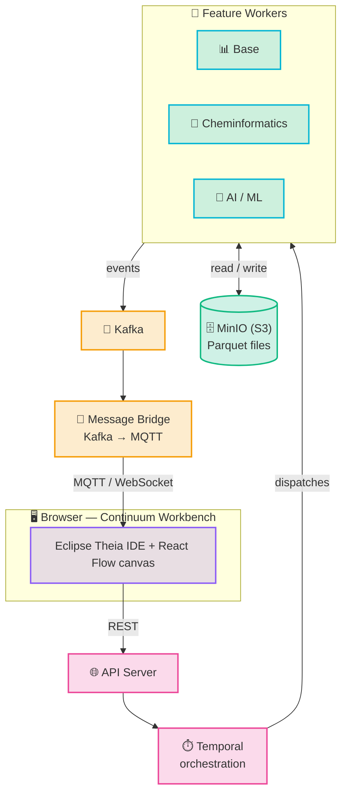
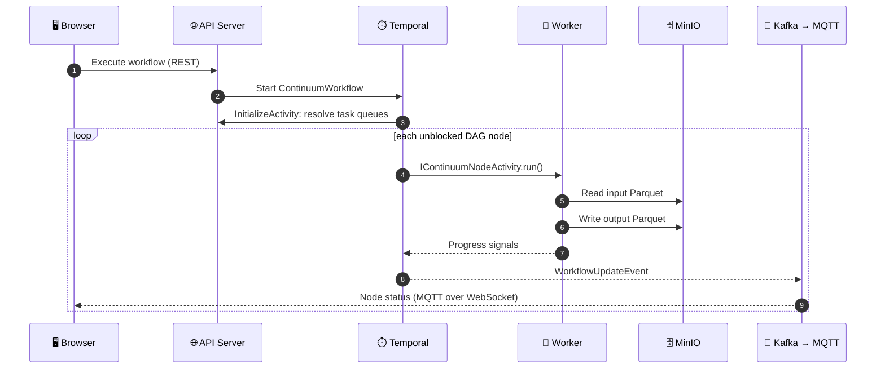

# System Overview

Continuum is split into a browser frontend, a core backend (API server + Temporal orchestration), and independent feature workers that provide the actual workflow nodes.

## Execution flow

<Steps>

1. You design a workflow in the browser (React Flow canvas) and hit **Execute**.
2. `continuum-api-server` receives the REST call and starts a Temporal workflow (`ContinuumWorkflow`, on `WORKFLOW_TASK_QUEUE`).
3. `InitializeActivity` resolves which task queue (= which worker) handles each node, via `POST /api/v1/node-explorer/nodes/task-queues` against the API server's node registry.
4. For each DAG node, `IContinuumNodeActivity.run()` is dispatched to the resolved worker's task queue (`ACTIVITY_TASK_QUEUE`). The worker downloads input Parquet from MinIO, runs `execute()`, and uploads output Parquet.
5. Nodes run in parallel where the DAG allows — `ContinuumWorkflow` waits for the first pending node to complete, then schedules newly unblocked nodes.
6. Each node sends progress signals; `ContinuumWorkflow` publishes a `WorkflowUpdateEvent` to Kafka.
7. `continuum-message-bridge` consumes the Kafka event and republishes it to Mosquitto (MQTT).
8. The browser receives the update over MQTT-over-WebSocket and lights up the corresponding node in real time.

</Steps>

The same flow as a sequence:

## Why this survives crashes

:::tip[Crash-proof by design]
Temporal persists workflow state (in PostgreSQL) at every step. If a worker process dies mid-execution, the orchestration service simply redispatches the pending activity once a worker becomes available again — no data loss, no restart from scratch.
:::

This is the "crash-proof execution" promise: a failed Kafka broker, a restarted worker pod, or a dropped network connection doesn't lose workflow progress.

## Task queues

Three Temporal task queues coordinate the system:

| Queue | Consumer | Purpose |
|-------|----------|---------|
| `WORKFLOW_TASK_QUEUE` | `ContinuumWorkflow` (orchestration service) | Drives the DAG execution loop |
| `ACTIVITY_TASK_QUEUE` | `ContinuumNodeActivity` (feature workers) | Runs individual node logic — name overridable per worker via `continuum.core.worker.node-task-queue` |
| `ACTIVITY_TASK_QUEUE_INITIALIZE` | `InitializeActivity` (orchestration service) | Resolves node → task queue routing before dispatch |

See [Node Model & Registration](./node-model.md) for how a worker's nodes end up in that registry in the first place, and [Data Format](./data-format.md) for how data actually moves between nodes.
