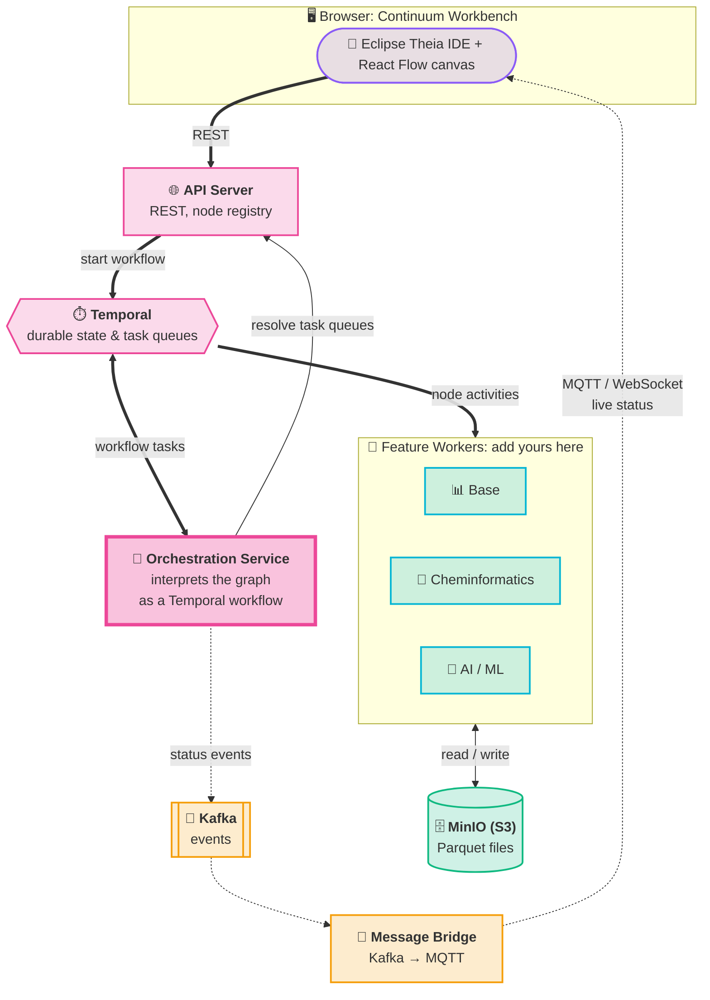
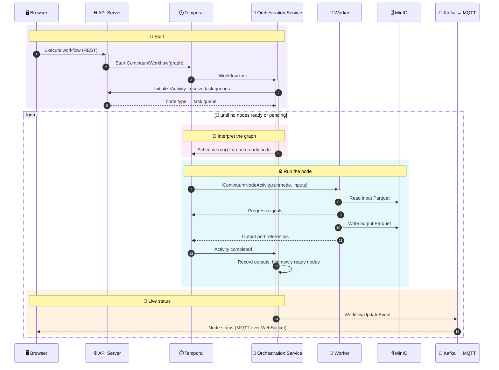

# System Overview

Continuum is split into a browser frontend, a core backend, and independent feature workers that provide the actual workflow nodes. The core backend has three parts: the API server, the **orchestration service**, which interprets the graph as a Temporal workflow, and the message bridge.

| Component | Role |
|-----------|------|
| `continuum-api-server` | REST entry point for the workbench, node registry, starts/cancels/terminates workflow runs |
| `continuum-orchestration-service` | Temporal workflow worker that interprets the canvas graph and drives execution. It schedules nodes, routes them to workers, wires outputs to inputs, and publishes status. See [Orchestration Service](./orchestration-service.md). |
| Temporal | Persists every step of the run and delivers workflow and activity tasks through task queues |
| Feature workers | Run the actual node logic (`execute()`) as Temporal activities |
| `continuum-message-bridge` | Forwards Kafka status events to the browser over MQTT, and maintains the node registry |

## Execution flow

<Steps>

1. You design a workflow in the browser (React Flow canvas) and hit **Execute**.
2. `continuum-api-server` validates the node properties, records a `PENDING` run, and starts a `ContinuumWorkflow` on `WORKFLOW_TASK_QUEUE`, passing the graph (nodes + edges) as input.
3. `continuum-orchestration-service` picks up the workflow task and begins interpreting the graph. Its `InitializeActivity` resolves which task queue (= which worker) handles each node type, via `POST /api/v1/node-explorer/nodes/task-queues` against the API server's node registry.
4. The orchestrator finds every node whose parents have all produced output and dispatches `IContinuumNodeActivity.run()` for each one to the resolved worker's task queue. Each node's inputs are wired from its parents' outputs along the graph's edges.
5. The worker downloads input Parquet from MinIO, runs `execute()`, uploads output Parquet, and returns references to the output files.
6. Nodes run in parallel where the DAG allows. The orchestrator waits for the first pending node to complete, records its outputs (or error), and schedules newly unblocked nodes, repeating until the graph is exhausted.
7. On every state change, and whenever a worker sends a progress signal, the orchestrator publishes a `WorkflowUpdateEvent` to Kafka.
8. `continuum-message-bridge` consumes the Kafka event and republishes it to Mosquitto (MQTT).
9. The browser receives the update over MQTT-over-WebSocket and lights up the corresponding node in real time.

</Steps>

The same flow as a sequence:

## Why this survives crashes

:::tip[Crash-proof by design]
Temporal persists workflow state (in PostgreSQL) at every step. If a worker process dies mid-execution, Temporal retries the pending activity once a worker becomes available again — no data loss, no restart from scratch. If the orchestration service itself restarts, another instance replays the workflow's history and resumes where the DAG loop left off.
:::

This is the "crash-proof execution" promise: a failed Kafka broker, a restarted worker or orchestrator pod, or a dropped network connection doesn't lose workflow progress.

## Task queues

Three Temporal task queues coordinate the system:

| Queue | Consumer | Purpose |
|-------|----------|---------|
| `WORKFLOW_TASK_QUEUE` | `ContinuumWorkflow` (orchestration service) | Drives the DAG execution loop |
| `ACTIVITY_TASK_QUEUE` | `ContinuumNodeActivity` (feature workers) | Runs individual node logic — name overridable per worker via `continuum.core.worker.node-task-queue` |
| `ACTIVITY_TASK_QUEUE_INITIALIZE` | `InitializeActivity` (orchestration service) | Resolves node → task queue routing before dispatch |

See [Orchestration Service](./orchestration-service.md) for how the graph is interpreted, [Node Model & Registration](./node-model.md) for how a worker's nodes end up in that registry in the first place, and [Data Format](./data-format.md) for how data actually moves between nodes.
