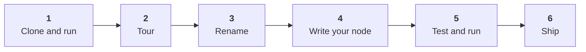

# Create New Nodes

<Lead>

Start from the **`continuum-feature-template`** repository, rename it, replace its example node with yours, and ship a worker. You write one Kotlin or Java class per node. The template provides everything else.

</Lead>

<Badges>
  <Badge color="cyan">Kotlin or Java</Badge>
  <Badge color="green">6 steps</Badge>
  <Badge color="amber">Platform 0.0.20</Badge>
</Badges>

## The idea in one minute

A **node** is a block on the Workbench canvas that reads tables, does something and writes tables. Nodes live in a **feature worker**, a small Spring Boot app that registers its nodes with the platform at startup.

You don't build a worker from scratch. The template is already a complete, working worker with two example nodes (one Kotlin, one Java), a build, tests, CI/CD, a Helm chart and a local stack. Your job is to rename it and swap in your own nodes.

## What you need

| Requirement | Notes |
|-------------|-------|
| JDK 21 | Eclipse Temurin recommended. Check with `java -version`. |
| Docker and Compose | Runs the local Continuum stack, about 8 GB of RAM. |
| Some Kotlin or Java | You don't need to know Temporal, Kafka or Spring internals. |
| A GitHub account | The template is used from GitHub, and the release steps run on GitHub Actions. |

You don't need a GitHub token, and you don't need to install Gradle: the repository includes the wrapper. Everything comes from Maven Central. To publish your work you also need Docker Hub (or another registry) credentials, and optionally a Maven Central account; [Step 6](./step-6-ship-it.md) covers both.

## The steps

<Steps>

1. [Clone the template and run it](./step-1-clone-and-run.md): see the example nodes working before you change anything.
2. [Tour the template](./step-2-tour-the-template.md): which files you write, which you rename and which you leave alone.
3. [Make it yours](./step-3-make-it-yours.md): a checklist for renaming the project, packages, worker and chart.
4. [Write your node](./step-4-write-your-node.md): the node class (Kotlin and Java), its help page and its unit test.
5. [Test and run your node](./step-5-test-and-run.md): build, run the worker and use your node in the Workbench.
6. [Ship it](./step-6-ship-it.md): versions, CI, release and Kubernetes.

</Steps>

After the six steps, [More node recipes](./recipes.md) covers adding more nodes, source nodes, credentials, retries, extra libraries, logging and debugging.

## Where to look when something breaks

- Your node doesn't appear in the Workbench: [Troubleshooting](./troubleshooting.md).
- The platform's side of registration: [Node Model & Feature Registration](../../architecture/node-model.md).
- A full list of errors and fixes, from the build to Kubernetes: [Troubleshooting](./troubleshooting.md).
- The template's own README and `AGENTS.md` list its commands and rules.

:::info[Versions]
Verified against **Continuum platform `0.0.20`** (Spring Boot 4.0.6, Kotlin 2.2, Jackson 3, Gradle 8.14, JDK 21). Check [Maven Central](https://central.sonatype.com/artifact/org.projectcontinuum.core/continuum-commons) for newer versions.
:::
