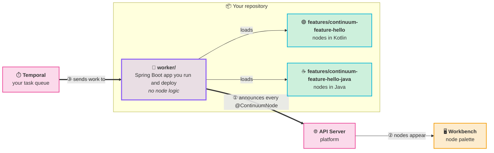

# Step 2: Tour the template

<Badges>
  <Badge color="purple">Step 2 of 6</Badge>
  <Badge color="blue">About 5 minutes</Badge>
</Badges>

The template has about 40 files, but you will only write code in a handful of them. This page shows which ones, and why the rest exist.

## The big picture

Your repository builds **one worker**. The worker is a small Spring Boot app that loads one or more **feature modules**. A feature module is a Gradle library that contains your node classes. The template ships two example modules, one in Kotlin and one in Java. You keep the one you write in and delete the other in [Step 3](./step-3-make-it-yours.md).



At startup the worker finds every class annotated with `@ContinuumNode`, listens on its own Temporal task queue for work, and announces each node to the platform so it shows up in the Workbench palette.

## Where things are

Each file or folder below is tagged with what you need to do with it.

| Tag | Meaning |
|-----|---------|
| **Write** | Your code goes here. You'll edit or add files. |
| **Rename once** | Contains the template's name. Change it in [Step 3](./step-3-make-it-yours.md), then forget about it. |
| **Keep in sync** | Several files must agree. If you change one, change the others. |
| **Leave alone** | Works as shipped. |

```text
continuum-feature-template/
├── gradle.properties                  Keep in sync  platform + feature versions
├── settings.gradle.kts                Rename once   project name + list of modules
├── build.gradle.kts                   Leave alone
│
├── features/
│   └── continuum-feature-hello/       Rename once   a feature module (Kotlin)
│       ├── build.gradle.kts           Rename once   group, description
│       └── src/
│           ├── main/kotlin/…/example/
│           │   ├── AutoConfigure.kt   Rename once   tells Spring where your nodes are
│           │   └── node/
│           │       └── HelloWorldNodeModel.kt   Write   ← your node
│           ├── main/resources/
│           │   ├── META-INF/spring/…AutoConfiguration.imports   Rename once
│           │   └── …/node/HelloWorldNodeModel.doc.md            Write   ← help page
│           └── test/kotlin/…/HelloWorldNodeModelTest.kt         Write   ← unit test
│
├── features/continuum-feature-hello-java/   Rename once   same layout in Java; delete whichever example you don't need
│
├── worker/
│   ├── build.gradle.kts               Keep in sync  which modules the worker loads, image name
│   └── src/main/
│       ├── kotlin/…/App.kt            Leave alone   Spring Boot entry point
│       └── resources/application.yaml Keep in sync  task queue, app name
│
├── charts/continuum-feature-template/ Keep in sync  Helm chart for Kubernetes
├── docker/                            Leave alone   local Continuum stack
├── .github/workflows/                 Keep in sync  CI and release (lists your modules)
└── README.md, CONTRIBUTING.md, AGENTS.md   Rename once   still describe the template
```

## The files that matter

### Files you write

These three live side by side in each feature module and share a name. The Java module has the same layout, with `HelloJavaNodeModel` and `.java` files:

| File | What it is |
|------|------------|
| `node/HelloWorldNodeModel.kt` | The node: ports, settings form and the `execute()` logic. |
| `resources/…/node/HelloWorldNodeModel.doc.md` | The help page the Workbench shows next to the node. The path must match the class's package and name exactly. |
| `test/…/HelloWorldNodeModelTest.kt` | Unit test. Runs without Spring, Kafka or Docker. |

### Files that connect your nodes to the platform

If you get one of the first three wrong, the build still passes but **the worker starts with no nodes**, and nothing in the build output tells you why. These are the most common reasons a new node doesn't appear.

| File | Why it matters |
|------|----------------|
| `AutoConfigure.kt` | A small `@Configuration` + `@ComponentScan` class. It makes Spring scan your package for nodes. Your node classes must live in this package or below. If `basePackages` doesn't cover your node's package, the node isn't found. |
| `META-INF/spring/…AutoConfiguration.imports` | One line naming the `AutoConfigure` class. Spring Boot reads this file to find your module. If the file is missing or names the wrong class, Spring doesn't load your module. |
| `worker/build.gradle.kts` | Its `implementation(project(...))` lines decide which feature modules the worker loads. A module that isn't listed here is never loaded. |
| `node/` package name | Node classes belong in a package ending in `.node`. The platform derives your **feature ID** by removing that last segment. (Other package names still load; the feature ID is then the whole package.) |

If a node doesn't appear after [Step 5](./step-5-test-and-run.md), follow the [checklist in Troubleshooting](./troubleshooting.md#my-node-doesnt-show-up-in-the-workbench).

### Files that must agree with each other

| Setting | Where it lives | Rule |
|---------|----------------|------|
| **Task queue** | `worker/src/main/resources/application.yaml` and `taskQueue` in `charts/*/values.yaml` | Must be **unique across all workers** and identical in both files. Two workers on one queue means Temporal can hand a node to a worker that doesn't have it. |
| **`featureVersion`** | `gradle.properties` and `appVersion` in `charts/*/Chart.yaml` | Must be equal. CI fails otherwise. |
| **`continuumPlatformVersion`** | `gradle.properties` only | Every module reads it with `property(...)`. Never hardcode it in a build file. |
| **Module list** | `settings.gradle.kts`, `worker/build.gradle.kts` and `.github/workflows/on-release.yml` + `build-module.yml` | Add or rename a module in all four. |

### Files you can ignore

- `docker/`: the local stack from Step 1. It has nothing of yours in it.
- `gradlew`, `gradle/`: the Gradle wrapper.
- `App.kt`: three lines that start Spring Boot.
- `charts/…/templates/`: Helm templates. You only touch them to rename (Step 3).

## What the Gradle plugins do for you

You don't declare Spring, Temporal, Jackson or test dependencies. The three Continuum plugins add them:

| Plugin | Used in | Gives you |
|--------|---------|-----------|
| `org.projectcontinuum.feature` | feature modules | Kotlin, Spring dependency management, `continuum-commons`, test libraries, and the `validateContinuumNodeAnnotations` check that fails the build if a node lacks `@ContinuumNode`. |
| `org.projectcontinuum.feature-java` | Java feature modules | The same, for Java. |
| `org.projectcontinuum.worker` | `worker/` | Spring Boot, the worker starter (Temporal polling and node registration), `bootRun`, and Jib for the container image. |

Add a `dependencies { }` block to a feature module only when your node needs an extra library; see [Add a library](./recipes.md#add-a-library). The plugin versions are the `continuumPlatformVersion` in `gradle.properties` (see the [version note in the overview](./overview.md#what-you-need)). For every setting and the other plugin IDs, see the [Gradle plugin reference](../../ecosystem/gradle-plugin.md).

Next: [rename the template](./step-3-make-it-yours.md).
