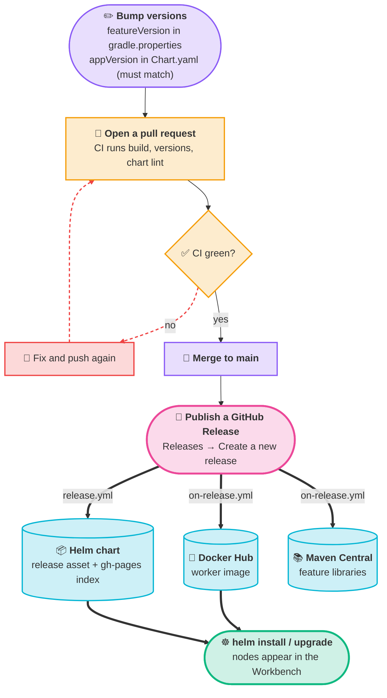

# Step 6: Ship it

<Badges>
  <Badge color="purple">Step 6 of 6</Badge>
  <Badge color="blue">Needs repository secrets</Badge>
</Badges>

Shipping is mostly already set up in the template. This page explains what each piece does, what you need to provide and how to install the result.

## The release flow



:::warning[Publish a GitHub Release]
After merging to `main`, create a release in the GitHub UI. That is what starts the publishing workflows.
:::

## 1. Bump the version

Every change under `features/` or `worker/` needs:
1. A new `featureVersion` in `gradle.properties`
2. The chart's `appVersion` in `charts/<repo>/Chart.yaml` set to the **same value**

CI enforces both on every pull request (`validate-versions.yml`). If your PR fails with "does not match featureVersion" or "featureVersion must be bumped", this is why.

**Example:**
```properties
# gradle.properties
featureVersion=0.0.2
```

```yaml
# charts/<repo>/Chart.yaml
appVersion: "0.0.2"   # Must match gradle.properties
```

The Docker image tag defaults to the chart's `appVersion`, so the chart installs exactly the image built from the same release.

## 2. What CI runs

| Workflow | When | What it does |
|----------|------|--------------|
| `ci.yml` | PR, push to `main` | `./gradlew build` |
| `validate-versions.yml` | PR | Checks the version rules above |
| `lint-test.yml` | PR touching `charts/` | `ct lint` on the Helm chart |
| `build-module.yml` | Manual | Build one module, optionally publish it |
| `on-release.yml` | GitHub release published | Libraries → Maven Central, worker → Docker Hub |
| `release.yml` | GitHub release published | Attach the packaged Helm chart to the release and update the `gh-pages` index |

:::info[Workflows are triggered by a published release]
`on-release.yml` and `release.yml` run when you **publish a GitHub Release** (Repository → Releases → Create a new release). Pushing a tag or merging to `main` doesn't trigger them.
:::

## 3. Add repository secrets

The release workflows read these from your repository's **Settings → Secrets and variables → Actions**:

| Secret | Used for | Required? |
|--------|----------|-----------|
| `MAVEN_CENTRAL_USERNAME`, `MAVEN_CENTRAL_PASSWORD` | Publishing libraries to Maven Central | If publishing to Maven Central |
| `GPG_KEY_ID`, `GPG_PASSPHRASE`, `GPG_SECRET_KEY`, `GPG_PUBLIC_KEY` | Signing the published artifacts | If publishing to Maven Central |
| `DOCKER_HUB_USERNAME`, `DOCKER_HUB_PASSWORD` | Pushing the worker image | Yes, unless you change the image registry (see [below](#4-where-the-image-goes)) |

### Publishing libraries to Maven Central

Maven Central only accepts artifacts whose `group` is a namespace you have **verified** in the Central Portal. Your feature module's `group` is your `<package>` (for example `com.acme.demo`), so verify `com.acme.demo`'s parent domain (`com.acme`) or use `io.github.<your-user>`. The Central Portal's namespace documentation explains the DNS or GitHub proof.

:::tip[Not publishing libraries?]
If your nodes only run in your own worker, you don't need Maven Central or the GPG secrets, and you don't need a verified namespace. Do both of these:

1. In each feature module's `continuum { }` block, add `publishToMavenCentral.set(false)`.
2. In `.github/workflows/on-release.yml`, set `publish_to_maven: false` for those modules.

Otherwise the release workflow tries to publish and fails on the missing secrets or namespace.
:::

## 4. Where the image goes

The worker image is built with Jib, so you don't need a Dockerfile and the CI runner doesn't need Docker. The target is `jibToImage` in `worker/build.gradle.kts`:

```kotlin
continuum {
    continuumVersion.set(continuumPlatformVersion)
    jibToImage.set("acme/continuum-feature-demo:${project.version}")
}
```

`on-release.yml` runs `./gradlew :worker:jib`, which pushes that image using the `DOCKER_REPO_USERNAME` and `DOCKER_REPO_PASSWORD` environment variables. The workflow fills them from `DOCKER_HUB_USERNAME` and `DOCKER_HUB_PASSWORD`.

To use **another registry** (GitHub Container Registry, a private registry), put its full address in `jibToImage` (for example `ghcr.io/acme/continuum-feature-demo:${project.version}`), keep the same environment variable names, and change the `env:` lines of the "Push container image" step in `on-release.yml` to read your registry's credentials. Also change `image.repository` in the chart's `values.yaml` to match.

If the registry is **private**, your cluster needs a pull secret. The template chart's `global.imagePullSecrets` value exists, but the Deployment template doesn't use it yet. Add this under `spec.template.spec` in `charts/<repo>/templates/deployment.yaml`:

```yaml
      {{- with .Values.global.imagePullSecrets }}
      imagePullSecrets:
        {{- toYaml . | nindent 8 }}
      {{- end }}
```

Then create the secret in the namespace (`kubectl create secret docker-registry …`) and list it in `values.yaml`:

```yaml
global:
  imagePullSecrets:
    - name: my-registry-secret
```

## 5. Configure the chart

The chart wires your worker to the rest of the platform through the `continuum:` block in `values.yaml`. Three parts of it need your attention:

| Values | What it is | When to change it |
|--------|-----------|-------------------|
| `continuum.infra.*` | Addresses of the shared services: Temporal (`host`, `port`, `namespace`), Kafka (`brokerList`), the schema registry (`url`) and MinIO (`endpoint`). | If you didn't install the `continuum-infra` chart under its default release name `continuum-infra`. Each address contains that release name. |
| `continuum.secrets.existingMinioSecret` | The name of the Kubernetes Secret that holds MinIO's `root-user` and `root-password`. Your chart doesn't create it; the `continuum-platform` chart does, named `<release-name>-minio-secret`. | If you installed `continuum-platform` under a name other than `continuum-platform`. |
| `continuum.apiServer` | `host` and `port` of the platform's API server, where your worker registers its nodes. The default is the service `continuum-platform-api-server` on port 8080. | Same: if the release name differs. |

Find the real service and secret names in your cluster with:

```bash
kubectl get svc,secret -n continuum
```

Your worker's own settings are under `continuum.<valuesKey>` (`image`, `replicas`, `taskQueue`, `resources`, `autoscaling`).

## 6. Verify before deployment

Before installing the chart, check the points that must agree:

- [ ] `taskQueue` in `charts/<repo>/values.yaml` matches `node-task-queue` in `application.yaml`
- [ ] `taskQueue` is globally unique (search other workers)
- [ ] `image.repository` in `values.yaml` matches what your release pushes
- [ ] The `continuum.infra.*`, `secrets.existingMinioSecret` and `apiServer` values match the release names in your cluster (see above)
- [ ] `helm lint charts/<repo>` passes

## 7. Install

You can install from your working copy, or from the chart your release published.

**From the repository (good for a first test):**

```bash
helm install <repo> ./charts/<repo> -n continuum
```

**From your release:** the `release.yml` workflow attaches the packaged chart (`<repo>-<version>.tgz`) to the GitHub release and adds it to the Helm index on your `gh-pages` branch. Enable GitHub Pages for the `gh-pages` branch in your repository settings (**Settings → Pages**), then:

```bash
helm repo add <repo> https://<org>.github.io/<repo>
helm repo update
helm install <repo> <repo>/<repo> -n continuum
```

For a private repository the index isn't publicly readable. Download the `.tgz` from the release and run `helm install <repo> ./<repo>-0.0.2.tgz -n continuum` instead.

To roll out a new version, publish a new release and run `helm upgrade`. See [Deployment](../../deployment/helm-charts.md) for the full Kubernetes setup, and confirm the result by looking for your nodes in the Workbench, or check the worker's log for `Registered process nodes: [...]`.

## Worker configuration reference

You don't need to set Kafka, MinIO or the API server addresses locally; the worker starter ships defaults that match the local stack. In Kubernetes, the chart sets these for you from `values.yaml`. Override them with environment variables when you deploy some other way:

| Variable | Default | Purpose |
|----------|---------|---------|
| `CONTINUUM_NODE_TASK_QUEUE` | from `application.yaml` | This worker's Temporal task queue |
| `TEMPORAL_SERVER_ADDRESS` | `localhost:7233` | Temporal frontend |
| `TEMPORAL_NAMESPACE` | `default` | Temporal namespace |
| `CONTINUUM_API_SERVER_BASE_URL` | `http://localhost:8080` | Where nodes register |
| `CONTINUUM_KAFKA_MAIN_BROKER_LIST` | `localhost:39092,localhost:39093,localhost:39094` | Kafka brokers |
| `CONTINUUM_KAFKA_MAIN_SCHEMA_REGISTRY` | `http://localhost:38080` | Schema registry |
| `CONTINUUM_MINIO_ENDPOINT` | `http://localhost:39000` | Object storage for node data |
| `CONTINUUM_MINIO_USERNAME` / `_PASSWORD` | `minioadmin` | MinIO credentials |
| `CONTINUUM_CREDENTIALS_SERVER_BASE_URL` | `http://localhost:8083` | Only for nodes that call `getCredential()`. The template chart doesn't set it; see [Use a credential](./recipes.md#use-a-credential). |
| `CONTINUUM_CACHE_STORAGE_PATH` | `./.continuum-cache/workflow-data` | Local scratch folder |
| `SERVER_PORT` | `8090` | Worker HTTP port (8080 belongs to the API server) |

You're done. Your worker is live and its nodes are available in the Workbench.
