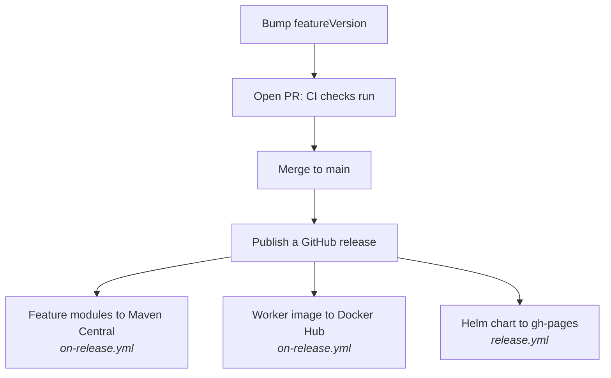

# Step 6: Ship it

<Badges>
  <Badge color="purple">Step 6 of 6</Badge>
  <Badge color="blue">Needs repository secrets</Badge>
</Badges>

Shipping is mostly already set up in the template. This page explains what each piece does and what you need to provide.

## The release flow



## 1. Bump the version

Every change under `features/` or `worker/` needs a new `featureVersion` in `gradle.properties`, and the chart's `appVersion` in `charts/<repo>/Chart.yaml` must be set to the same value.

CI enforces both on every pull request (`validate-versions.yml`). If your PR fails with "does not match featureVersion" or "featureVersion must be bumped", this is why.

## 2. What CI runs

| Workflow | When | What it does |
|----------|------|--------------|
| `ci.yml` | PR, push to `main` | `./gradlew build` |
| `validate-versions.yml` | PR | Checks the version rules above |
| `lint-test.yml` | PR touching `charts/` | `ct lint` on the Helm chart |
| `build-module.yml` | Manual | Build one module, optionally publish it |
| `on-release.yml` | GitHub release | Libraries → Maven Central, worker → Docker Hub |
| `release.yml` | GitHub release | Package the Helm chart and update the `gh-pages` index |

## 3. Add repository secrets

The release workflows read these from your repository's **Settings → Secrets and variables → Actions**:

| Secret | Used for |
|--------|----------|
| `MAVEN_CENTRAL_USERNAME`, `MAVEN_CENTRAL_PASSWORD` | Publishing libraries to Maven Central |
| `GPG_KEY_ID`, `GPG_PASSPHRASE`, `GPG_SECRET_KEY`, `GPG_PUBLIC_KEY` | Signing the published artifacts |
| `DOCKER_HUB_USERNAME`, `DOCKER_HUB_PASSWORD` | Pushing the worker image |

:::tip[Not publishing libraries?]
If your nodes only run in your own worker, you don't need Maven Central or the GPG secrets. In each feature module's `continuum { }` block set `publishToMavenCentral.set(false)`, and set `publish_to_maven: false` for those modules in `on-release.yml`.
:::

## 4. Deploy to Kubernetes

The chart installs next to `continuum-infra` and `continuum-platform` in the same namespace:

```bash
helm install <repo> ./charts/<repo> -n continuum
```

Check these before you install:

- `taskQueue` in `values.yaml` matches `node-task-queue` in `application.yaml`, and is unique.
- `image.repository` is the image your release pushes.
- The `continuum.infra.*` and `apiServer` hosts match the release names you used for `continuum-infra` and `continuum-platform`.

See [Deployment](../../deployment/helm-charts.md) for the full setup.

## Worker configuration reference

You don't need to set Kafka, MinIO or the API server addresses; the worker starter ships defaults that match the local stack. Override them with environment variables when you deploy elsewhere:

| Variable | Default | Purpose |
|----------|---------|---------|
| `CONTINUUM_NODE_TASK_QUEUE` | from `application.yaml` | This worker's Temporal task queue |
| `TEMPORAL_SERVER_ADDRESS` | `localhost:7233` | Temporal frontend |
| `TEMPORAL_NAMESPACE` | `default` | Temporal namespace |
| `CONTINUUM_API_SERVER_BASE_URL` | `http://localhost:8080` | Where nodes register |
| `CONTINUUM_KAFKA_MAIN_BROKER_LIST` | `localhost:39092,localhost:39093,localhost:39094` | Kafka brokers |
| `CONTINUUM_KAFKA_MAIN_SCHEMA_REGISTRY` | `http://localhost:38080` | Schema registry |
| `CONTINUUM_MINIO_ENDPOINT` | `http://localhost:39000` | Object storage for node data |
| `CONTINUUM_MINIO_USERNAME` / `_PASSWORD` | `minioadmin` | MinIO credentials |
| `CONTINUUM_CREDENTIALS_SERVER_BASE_URL` | `http://localhost:8083` | Only for nodes that call `getCredential()` |
| `CONTINUUM_CACHE_STORAGE_PATH` | `./.continuum-cache/workflow-data` | Local scratch folder |
| `SERVER_PORT` | `8090` | Worker HTTP port (8080 belongs to the API server) |

You're done. Your worker is live and its nodes are available in the Workbench.
