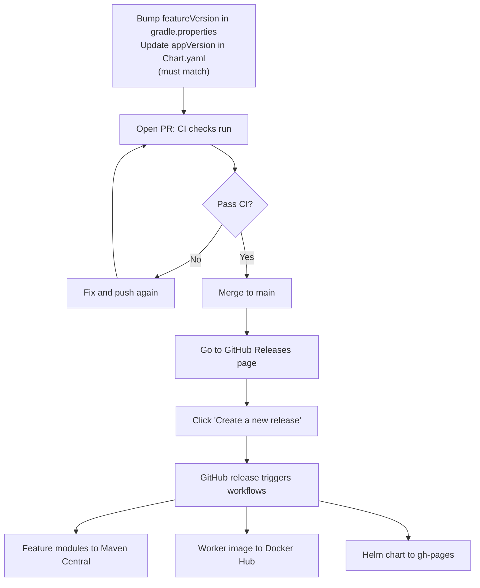

# Step 6: Ship it

<Badges>
  <Badge color="purple">Step 6 of 6</Badge>
  <Badge color="blue">Needs repository secrets</Badge>
</Badges>

Shipping is mostly already set up in the template. This page explains what each piece does and what you need to provide.

## The release flow



:::warning[Key Step: Create a GitHub Release]
After merging to main, you must go to the GitHub UI and create a release. Don't just tag the commit or push a version. **Go to:** Repository → Releases → Create a new release

This triggers the `on-release.yml` and `release.yml` workflows that publish your artifacts.
:::

## 1. Bump the version

Every change under `features/` or `worker/` needs:
1. A new `featureVersion` in `gradle.properties`
2. The chart's `appVersion` in `charts/<repo>/Chart.yaml` set to the **same value**

CI enforces both on every pull request (`validate-versions.yml`). If your PR fails with "does not match featureVersion" or "featureVersion must be bumped", this is why.

**Example:**
```properties
# gradle.properties
featureVersion=0.0.2
```

```yaml
# charts/<repo>/Chart.yaml
appVersion: "0.0.2"   # Must match gradle.properties
```

## 2. What CI runs

| Workflow | When | What it does |
|----------|------|--------------|
| `ci.yml` | PR, push to `main` | `./gradlew build` |
| `validate-versions.yml` | PR | Checks the version rules above |
| `lint-test.yml` | PR touching `charts/` | `ct lint` on the Helm chart |
| `build-module.yml` | Manual | Build one module, optionally publish it |
| `on-release.yml` | ⭐ **GitHub release published** | Libraries → Maven Central, worker → Docker Hub |
| `release.yml` | ⭐ **GitHub release published** | Package the Helm chart and update the `gh-pages` index |

:::info[Workflows are triggered by Release, not by Tag or Push]
The workflows that publish your artifacts (`on-release.yml` and `release.yml`) run when you **publish a GitHub Release**. They don't run on tags or commits. You must explicitly create a release in the GitHub UI.
:::

## 3. Add repository secrets

The release workflows read these from your repository's **Settings → Secrets and variables → Actions**:

| Secret | Used for | Required? |
|--------|----------|-----------|
| `MAVEN_CENTRAL_USERNAME`, `MAVEN_CENTRAL_PASSWORD` | Publishing libraries to Maven Central | If publishing to Maven Central |
| `GPG_KEY_ID`, `GPG_PASSPHRASE`, `GPG_SECRET_KEY`, `GPG_PUBLIC_KEY` | Signing the published artifacts | If publishing to Maven Central |
| `DOCKER_HUB_USERNAME`, `DOCKER_HUB_PASSWORD` | Pushing the worker image | Yes, always needed |

:::tip[Not publishing libraries?]
If your nodes only run in your own worker, you don't need Maven Central or the GPG secrets. In each feature module's `continuum { }` block set `publishToMavenCentral.set(false)`, and set `publish_to_maven: false` for those modules in `on-release.yml`.

You still need Docker Hub secrets to publish the worker image.
:::

## 4. Verify before deployment

Before installing the chart to Kubernetes, verify these critical synchronization points:

- [ ] `taskQueue` in `charts/<repo>/values.yaml` matches `node-task-queue` in `application.yaml`
- [ ] `taskQueue` is globally unique (search other workers)
- [ ] `image.repository` in values.yaml matches what your release pushes to Docker Hub
- [ ] The `continuum.infra.*` and `apiServer` hosts match the release names of other Continuum services

Then install:

```bash
helm install <repo> ./charts/<repo> -n continuum
```

See [Deployment](../../deployment/helm-charts.md) for the full Kubernetes setup.

## Worker configuration reference

You don't need to set Kafka, MinIO or the API server addresses; the worker starter ships defaults that match the local stack. Override them with environment variables when you deploy elsewhere:

| Variable | Default | Purpose |
|----------|---------|---------|
| `CONTINUUM_NODE_TASK_QUEUE` | from `application.yaml` | This worker's Temporal task queue |
| `TEMPORAL_SERVER_ADDRESS` | `localhost:7233` | Temporal frontend |
| `TEMPORAL_NAMESPACE` | `default` | Temporal namespace |
| `CONTINUUM_API_SERVER_BASE_URL` | `http://localhost:8080` | Where nodes register |
| `CONTINUUM_KAFKA_MAIN_BROKER_LIST` | `localhost:39092,localhost:39093,localhost:39094` | Kafka brokers |
| `CONTINUUM_KAFKA_MAIN_SCHEMA_REGISTRY` | `http://localhost:38080` | Schema registry |
| `CONTINUUM_MINIO_ENDPOINT` | `http://localhost:39000` | Object storage for node data |
| `CONTINUUM_MINIO_USERNAME` / `_PASSWORD` | `minioadmin` | MinIO credentials |
| `CONTINUUM_CREDENTIALS_SERVER_BASE_URL` | `http://localhost:8083` | Only for nodes that call `getCredential()` |
| `CONTINUUM_CACHE_STORAGE_PATH` | `./.continuum-cache/workflow-data` | Local scratch folder |
| `SERVER_PORT` | `8090` | Worker HTTP port (8080 belongs to the API server) |

You're done. Your worker is live and its nodes are available in the Workbench.
