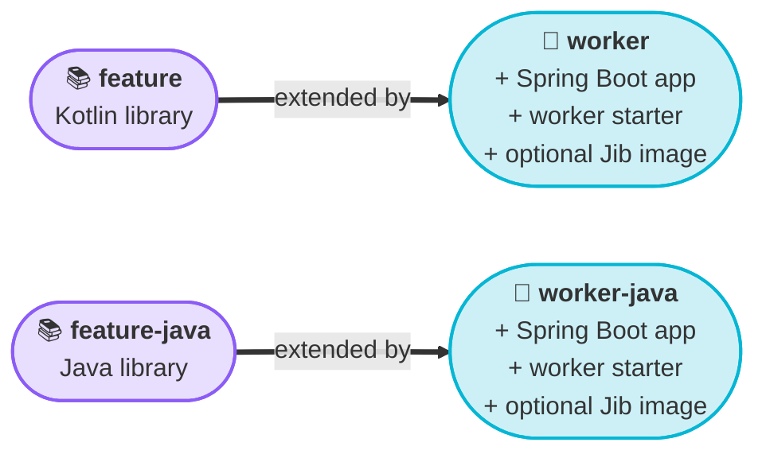

# Continuum Gradle Plugin

<Lead>

The **Continuum Gradle plugin** turns an empty Gradle module into a Continuum feature library or a runnable worker. You apply one plugin ID, set a version, and get Spring Boot, the Continuum libraries, tests, publishing and container images configured for you.

</Lead>

<Badges>
  <Badge color="cyan">4 plugin IDs</Badge>
  <Badge color="purple">Kotlin or Java</Badge>
  <Badge color="amber">Platform 0.0.20</Badge>
</Badges>

Use this page when you start a project **from scratch**. If you would rather start from a working repository, clone the template instead ([Create New Nodes](../contributing/create-new-nodes/overview.md)); the template uses exactly the setup described here.

## What you get

The plugin ships as one artifact, `org.projectcontinuum.core:continuum-gradle-plugin`, which registers four plugin IDs:

| Plugin ID | Use it for | Language |
|-----------|------------|----------|
| `org.projectcontinuum.feature` | A **library module** that contains nodes | Kotlin |
| `org.projectcontinuum.feature-java` | A library module that contains nodes | Java |
| `org.projectcontinuum.worker` | The **runnable worker** (Spring Boot app) that loads your feature modules | Kotlin |
| `org.projectcontinuum.worker-java` | The runnable worker | Java |

A worker plugin first applies the matching feature plugin and then adds the application parts, so everything a feature module gets, a worker gets too.



You can mix languages. The template has a Kotlin worker that loads both a Kotlin and a Java feature module.

Every plugin gives you:

- **Dependencies:** Spring Boot starters, `continuum-commons`, Jackson 3 and the test libraries, with Spring Boot, Spring Cloud and Temporal BOMs imported.
- **Build setup:** a Java 21 toolchain, JUnit 5, sources and Javadoc jars, and Maven Central, Confluent and local Maven repositories.
- **A build-time check** that every node class carries `@ContinuumNode` ([details](#node-annotation-check)).
- **Publishing** to Maven Central through JReleaser ([details](#publishing-libraries)).

The worker plugins add the `continuum-worker-springboot-starter`, the Spring Boot application plugin (`bootJar`, `bootRun`) and, when you ask for it, a container image built with Jib ([details](#container-images)).

## Start a project from scratch

This walks through a minimal repository with one feature module and one worker. It uses Kotlin; for Java, swap the plugin IDs as noted.

**You need:** JDK 21. Use Gradle 8.14, the version the template's wrapper pins and the one this page was checked with.

### 1. Lay out the repository

```text
my-continuum-worker/
├── gradle.properties
├── settings.gradle.kts
├── build.gradle.kts
├── gradlew, gradlew.bat, gradle/        ← the Gradle wrapper
├── features/
│   └── my-feature/
│       ├── build.gradle.kts
│       └── src/main/…                   ← your nodes
└── worker/
    ├── build.gradle.kts
    └── src/main/…                       ← the Spring Boot app
```

For the wrapper, copy `gradlew`, `gradlew.bat` and the `gradle/` folder from the template, or run `gradle wrapper --gradle-version 8.14` if you have Gradle installed.

### 2. Pin one platform version

Put the Continuum version in `gradle.properties` so the plugin version and the library version can't drift apart:

```properties
# gradle.properties
continuumPlatformVersion=0.0.20
featureVersion=0.0.1

# Gradle needs more memory to compile with Spring Boot 4 and Kotlin 2.2
org.gradle.jvmargs=-Xmx4g -XX:MaxMetaspaceSize=1g
```

`continuumPlatformVersion` is the version of the plugin **and** of the Continuum libraries it adds. They are released together, so use the same value for both.

### 3. Declare the plugins in `settings.gradle.kts`

```kotlin
// settings.gradle.kts
pluginManagement {
    val continuumPlatformVersion: String by settings
    repositories {
        mavenCentral()
        gradlePluginPortal()
    }
    plugins {
        id("org.projectcontinuum.feature") version continuumPlatformVersion
        id("org.projectcontinuum.worker") version continuumPlatformVersion
        // Java modules: also declare feature-java and/or worker-java
    }
}

rootProject.name = "my-continuum-worker"

include(":features:my-feature")
include(":worker")
```

Declaring the versions once here means the module build files apply the plugins by ID only. Add `mavenLocal()` to the repositories only when you are testing a plugin build you made yourself.

The root `build.gradle.kts` can stay empty. The template adds `plugins { id("org.jreleaser") version "1.23.0" apply false }` there; a multi-module build without it also configured and built in our checks, so it is optional.

### 4. Create the feature module

```kotlin
// features/my-feature/build.gradle.kts
plugins {
    id("org.projectcontinuum.feature")
}

group = "com.acme.demo"
description = "My Continuum nodes"
version = property("featureVersion").toString()

continuum {
    continuumVersion.set(property("continuumPlatformVersion").toString())
}
```

:::warning[Always set continuumVersion]
`continuumVersion` has a built-in default of `0.0.6`, which is **not** the current platform. If you leave it out, the module quietly builds against old Continuum libraries and you get confusing compile errors. Set it in every module that applies a Continuum plugin.
:::

`group` and `version` matter: they become the Maven coordinates when you publish the module.

For a Java module use `id("org.projectcontinuum.feature-java")`.

### 5. Register the module's nodes

The worker finds your nodes through Spring auto-configuration. Add one class and one file to the feature module:

```kotlin
// features/my-feature/src/main/kotlin/com/acme/demo/AutoConfigure.kt
package com.acme.demo

import org.springframework.context.annotation.ComponentScan
import org.springframework.context.annotation.Configuration

@Configuration
@ComponentScan(basePackages = ["com.acme.demo"])
class AutoConfigure
```

```text
# features/my-feature/src/main/resources/META-INF/spring/org.springframework.boot.autoconfigure.AutoConfiguration.imports
com.acme.demo.AutoConfigure
```

Now write your nodes in `com.acme.demo` or a sub-package. [Step 4: Write your node](../contributing/create-new-nodes/step-4-write-your-node.md) covers the node class, help page and tests.

### 6. Create the worker

```kotlin
// worker/build.gradle.kts
plugins {
    id("org.projectcontinuum.worker")
}

group = "com.acme.demo.worker"
description = "My Continuum worker"
version = property("featureVersion").toString()

continuum {
    continuumVersion.set(property("continuumPlatformVersion").toString())
}

dependencies {
    implementation(project(":features:my-feature"))
}
```

Add the application class and its configuration:

```kotlin
// worker/src/main/kotlin/com/acme/demo/worker/App.kt
package com.acme.demo.worker

import org.springframework.boot.autoconfigure.SpringBootApplication
import org.springframework.boot.runApplication

@SpringBootApplication
class App

fun main(args: Array<String>) {
    runApplication<App>(*args)
}
```

```yaml
# worker/src/main/resources/application.yaml
spring.application.name: my-continuum-worker

# 8080 is taken by the API server in the local stack
server.port: ${SERVER_PORT:8090}

spring:
  temporal:
    namespace: ${TEMPORAL_NAMESPACE:default}
    connection:
      target: ${TEMPORAL_SERVER_ADDRESS:localhost:7233}
    workersAutoDiscovery:
      packages:
        - org.projectcontinuum.core.worker.starter

continuum.core:
  worker:
    # Must be unique per worker
    node-task-queue: ${CONTINUUM_NODE_TASK_QUEUE:MY_CONTINUUM_WORKER_TASK_QUEUE}
```

The worker starter supplies defaults for Kafka, MinIO and the API server that match the local stack, so these are the only settings you must provide. The [Step 6 reference](../contributing/create-new-nodes/step-6-ship-it.md#worker-configuration-reference) lists the environment variables you can override, and the unique task queue rule is explained in [Step 3](../contributing/create-new-nodes/step-3-make-it-yours.md#pick-your-values).

### 7. Build and run

```bash
./gradlew build
./gradlew :worker:bootRun
```

`bootRun` needs the local Continuum stack; see [Step 5](../contributing/create-new-nodes/step-5-test-and-run.md) for starting it and seeing your nodes in the Workbench. A successful start logs `Registered process nodes: [...]` with your node classes.

## The `continuum { }` block

Every module that applies a Continuum plugin gets a `continuum { }` block. All properties are optional, except that you should always set `continuumVersion`.

```kotlin
continuum {
    continuumVersion.set("0.0.20")
    publishToMavenCentral.set(false)
    jibToImage.set("acme/my-worker:${project.version}")
}
```

| Property | Type | Default | Applies to | What it does |
|----------|------|---------|------------|--------------|
| `continuumVersion` | String | `0.0.6` | all | Version of `continuum-commons` and, for workers, `continuum-worker-springboot-starter`. **Set this.** |
| `continuumGroup` | String | `org.projectcontinuum.core` | all | Maven group of those two Continuum artifacts. Change only if you use a fork. |
| `useKotlin` | Boolean | `true` for `feature`/`worker`, `false` for the `-java` plugins | all | Chosen for you by the plugin ID. It decides which dependencies are added (Kotlin or Java Jackson and test libraries) and where the node check looks for classes. Leave it alone. |
| `springBootVersion` | String | `4.0.6` | all | Version of the `spring-boot-dependencies` BOM. The Spring Boot **Gradle plugin** version is fixed by the Continuum plugin. |
| `springCloudVersion` | String | `2025.1.1` | all | Version of the Spring Cloud BOM. |
| `temporalVersion` | String | `1.28.0` | all | Version of the Temporal BOM. |
| `jacksonVersion` | String | `3.1.2` | all | Version of the Jackson 3 artifacts (`tools.jackson.*`) added directly. |
| `awsSdkVersion` | String | `2.30.7` | workers | Version of the AWS SDK BOM. |
| `publishToMavenCentral` | Boolean | `true` | all | Configures signing and the Maven Central deployment ([details](#publishing-libraries)). Set `false` if you don't publish the module. |
| `jibFromImage` | String | `eclipse-temurin:21-jre` | workers | Base image for the container. |
| `jibToImage` | String | none | workers | Target image, for example `acme/my-worker:1.0.0`. If unset, **no container image is configured at all**. |

The defaults are the ones in plugin `0.0.20`; later releases may move them. Normally you only touch `continuumVersion`, `publishToMavenCentral` and `jibToImage` and leave the rest, because the platform is tested against its own defaults.

:::info[Values are read after your build script runs]
The plugins add dependencies and BOMs after your build script is evaluated, so set versions through `continuum { }` rather than trying to edit the generated dependency lines.
:::

## What each plugin applies

### Feature plugins

| | `feature` (Kotlin) | `feature-java` |
|--|--------------------|----------------|
| Language plugins | `org.jetbrains.kotlin.jvm` and `org.jetbrains.kotlin.plugin.spring` (Kotlin 2.2.0) | `java-library` |
| Always applied | Spring dependency management, `maven-publish`, JReleaser | the same |
| Compiler options | `-Xjsr305=strict` | none |
| JSON library | `tools.jackson.module:jackson-module-kotlin`, `kotlin-reflect` | `tools.jackson.core:jackson-databind` |
| Test libraries | `kotlin-test-junit5`, `mockito-kotlin` | `junit-jupiter`, `mockito-core` |

You don't declare Kotlin or Spring Boot plugin versions yourself; the Continuum plugin brings them.

Both feature plugins also set up:

- **Toolchain:** Java 21, plus `withSourcesJar()` and `withJavadocJar()`, which Maven Central requires.
- **Repositories:** `mavenLocal()`, `mavenCentral()` and the Confluent repository (`packages.confluent.io/maven`).
- **Tests:** every `Test` task uses the JUnit Platform.
- **Dependencies** (`implementation`): `spring-boot-starter`, `spring-boot-autoconfigure`, `spring-boot-starter-web`, `spring-boot-starter-actuator` and `continuum-commons`.
- **Test dependencies:** `spring-boot-starter-test` and the JUnit launcher, plus the language-specific libraries above.
- **BOMs:** `spring-boot-dependencies`, `temporal-bom` and `spring-cloud-dependencies`.
- **The node check** (`validateContinuumNodeAnnotations`) and **publishing**, described below.

### Worker plugins

A worker plugin applies its feature plugin and then adds:

- the `org.springframework.boot` plugin, which gives you `bootJar` and `bootRun`;
- the `software.amazon.awssdk:bom` BOM;
- `continuum-worker-springboot-starter` as an `implementation` dependency;
- Jib, **only if** `jibToImage` is set.

Because a worker is also a feature module, it is publishable too. In practice you publish its container image, not its jar; the template's release workflow publishes libraries and the worker image separately ([Step 6](../contributing/create-new-nodes/step-6-ship-it.md)).

## Node annotation check

Every node class needs `@ContinuumNode`, and a missing annotation is easy to overlook until the node doesn't show up. The plugins catch this at build time with the task `validateContinuumNodeAnnotations`.

- It is in the `verification` group and runs before `classes`, so `./gradlew build`, `test` and `bootRun` all trigger it.
- It scans the compiled classes of the module (`build/classes/kotlin/main` or `build/classes/java/main`) for concrete classes that implement `ContinuumNodeModel` (which `ProcessNodeModel` and `TriggerNodeModel` do) and lack the annotation.
- It skips abstract classes, interfaces, inner classes and anonymous classes.
- If `continuum-commons` isn't on the classpath, it does nothing.

A missing annotation fails the build with a message that names the class:

```text
Execution failed for task ':features:my-feature:validateContinuumNodeAnnotations'.
> Continuum Node Annotation Validation Failed
  The following classes implement ContinuumNodeModel but are missing the @ContinuumNode annotation:
    - com.acme.demo.BadNodeModel
```

Add `@ContinuumNode` to the class and rebuild.

## Publishing libraries

A feature module can be published to Maven Central so other workers can depend on your nodes. The plugin configures this in two stages.

1. **Stage locally.** A `mavenJava` publication (the jar, sources jar and Javadoc jar, with a full POM) is published to a repository called `localStaging` at `build/staging-deploy`:
   ```bash
   ./gradlew :features:my-feature:publish
   ```
2. **Deploy.** JReleaser signs the staged files with PGP and uploads them to the Maven Central Portal:
   ```bash
   ./gradlew :features:my-feature:jreleaserDeploy
   ```

The Maven coordinates come from the module's `group`, `name` and `version`. The POM links to your repository using the `GITHUB_REPOSITORY` environment variable (set automatically on GitHub Actions) or, locally, a `repoName` property in `gradle.properties` (for example `repoName=my-org/my-repo`).

The POM also lists a fixed developer and the Apache 2.0 license. The developer entry is `Continuum Developer`, and the extension has no setting to change it.

### Credentials

| Variable | Used by | Purpose |
|----------|---------|---------|
| `JRELEASER_MAVENCENTRAL_SONATYPE_USERNAME`, `JRELEASER_MAVENCENTRAL_SONATYPE_TOKEN` | `jreleaserDeploy` | Maven Central Portal account |
| `JRELEASER_GPG_PASSPHRASE`, `JRELEASER_GPG_SECRET_KEY`, `JRELEASER_GPG_PUBLIC_KEY` | `jreleaserDeploy` | Signing key |
| `MAVEN_REPO_USERNAME`, `MAVEN_REPO_PASSWORD` | `publish`, for `-SNAPSHOT` versions only | Sonatype snapshots repository |

The template's `on-release.yml` maps its repository secrets to these variables; see [Step 6](../contributing/create-new-nodes/step-6-ship-it.md#3-add-repository-secrets). Signing is always on, so `jreleaserDeploy` fails without the GPG variables.

Your module's `group` must be a namespace you have verified in the Maven Central Portal.

### Snapshots

If the module's version ends in `-SNAPSHOT`, `publish` also pushes to the Sonatype snapshots repository (`central.sonatype.com/repository/maven-snapshots/`) using the `MAVEN_REPO_*` variables.

### Turn publishing off

If a module is only used inside your own worker, don't publish it:

```kotlin
continuum {
    publishToMavenCentral.set(false)
}
```

This leaves out the signing and Maven Central deployment settings. The `maven-publish` and JReleaser plugins stay applied, so the tasks still exist, but don't run `jreleaserDeploy` for that module. Remember to turn it off in your release workflow as well.

## Container images

Worker plugins build container images with [Jib](https://github.com/GoogleContainerTools/jib), so you need no Dockerfile and no Docker daemon in CI.

Jib is **opt-in**. Set `jibToImage` and the plugin applies Jib and configures it; leave it unset and no Jib tasks exist.

```kotlin
continuum {
    continuumVersion.set(property("continuumPlatformVersion").toString())
    jibToImage.set("acme/my-worker:${project.version}")
    // jibFromImage.set("eclipse-temurin:21-jre")   // the default
}
```

| Setting | Value |
|---------|-------|
| Base image | `jibFromImage` (default `eclipse-temurin:21-jre`) |
| Target image | `jibToImage` |
| Registry login | `DOCKER_REPO_USERNAME` and `DOCKER_REPO_PASSWORD` environment variables; empty if unset |

Build and push with:

```bash
./gradlew :worker:jib                # push to the registry
./gradlew :worker:jibDockerBuild     # build into your local Docker daemon
./gradlew :worker:jibBuildTar        # build a tarball
```

To use a registry other than Docker Hub, put its full address in `jibToImage` (for example `ghcr.io/acme/my-worker:1.0.0`) and set the two environment variables to that registry's credentials.

## Task reference

| Task | Added by | What it does |
|------|----------|--------------|
| `validateContinuumNodeAnnotations` | all | Fails the build if a node class lacks `@ContinuumNode`. Runs before `classes`. |
| `publish` | all | Stages the library into `build/staging-deploy` (and Sonatype snapshots for `-SNAPSHOT` versions). |
| `publishToMavenLocal` | all | Installs the library into `~/.m2`. Useful for trying a module in another project. |
| `jreleaserDeploy` | all | Signs and deploys the staged artifacts to Maven Central. Needs `publishToMavenCentral` left `true`. |
| `bootRun` | workers | Starts the worker from Gradle. |
| `bootJar` | workers | Builds the executable Spring Boot jar. |
| `jib`, `jibDockerBuild`, `jibBuildTar` | workers, only when `jibToImage` is set | Build the container image. |

Run `./gradlew :worker:tasks --all` to see everything, including the other JReleaser tasks.

## Troubleshooting

| Symptom | Cause and fix |
|---------|---------------|
| `Plugin [id: 'org.projectcontinuum.feature', version: '…'] was not found` | The version isn't a released one, or `pluginManagement.repositories` in `settings.gradle.kts` lacks `mavenCentral()`. |
| Compile errors for Continuum classes you know exist, or the wrong API | `continuumVersion` isn't set and defaulted to `0.0.6`. Set it in every module's `continuum { }` block. |
| `validateContinuumNodeAnnotations FAILED` | A class extends `ProcessNodeModel` or `TriggerNodeModel` without `@ContinuumNode`. See [above](#node-annotation-check). |
| `Unresolved reference` on `ObjectMapper` or `TypeReference` | Jackson 2 imports. The plugin adds Jackson 3; import `tools.jackson.databind.ObjectMapper` and `tools.jackson.core.type.TypeReference`. |
| `Unsupported class file major version` or a toolchain error | Gradle isn't running on JDK 21. Check `java -version` and `./gradlew --version`, set `JAVA_HOME`, and run `./gradlew --stop`. |
| Gradle daemon runs out of memory | Add `org.gradle.jvmargs=-Xmx4g -XX:MaxMetaspaceSize=1g` to `gradle.properties`. |
| `Task 'jib' not found` | `jibToImage` isn't set in that module's `continuum { }` block, so Jib was never applied. |
| `jreleaserDeploy` fails on signing or credentials | The GPG or Sonatype environment variables are missing. Provide them, or set `publishToMavenCentral.set(false)`. |
| `jib` fails with `401 Unauthorized` | `DOCKER_REPO_USERNAME` / `DOCKER_REPO_PASSWORD` are missing, or the account can't push to the image name in `jibToImage`. |
| The worker starts but registers no nodes | Not a plugin problem: check the `AutoConfiguration.imports` file and `@ComponentScan`. See [Troubleshooting](../contributing/create-new-nodes/troubleshooting.md#my-node-doesnt-show-up-in-the-workbench). |

## Where the plugin lives

The source is in the `continuum-gradle-plugin` module of [`continuum-platform-core`](https://github.com/projectcontinuum-org/continuum-platform-core). Its version always equals the platform version. To pick up a new platform release, change `continuumPlatformVersion` in `gradle.properties` and rebuild.
