# Local Setup

<Lead>

The [`continuum-local-setup`](https://github.com/projectcontinuum-org/continuum-local-setup) repo gives you a single `docker compose up` that launches the **complete** Project Continuum stack — infrastructure services, platform backend, browser IDE, and feature workers — all wired together and ready to go.

</Lead>

<Badges>
  <Badge color="blue">🐳 Docker only</Badge>
  <Badge color="pink">No builds</Badge>
</Badges>

No builds. No cloning five repos. Just Docker.

## Prerequisites

<CardGrid cols={4}>
  <Card icon="🐳" title="Docker" color="blue">20.10+</Card>
  <Card icon="🧩" title="Docker Compose" color="cyan">v2.0+</Card>
  <Card icon="🧠" title="RAM" color="purple">8 GB available for containers</Card>
  <Card icon="💾" title="Disk" color="amber">~5 GB for images + volumes</Card>
</CardGrid>

## Quick start

<Steps>

1. Clone the repo and start the stack:

   ```bash
   git clone https://github.com/projectcontinuum-org/continuum-local-setup.git
   cd continuum-local-setup/docker
   docker compose up -d
   ```

2. Verify everything is running:

   ```bash
   docker compose ps
   ```

   All services should show `running` (the `temporal-search-attributes-init` container exits after setup — that's expected).

3. Open the [Continuum Workbench](http://127.0.0.1:3002/#/home/node/example-workflows). Example workflows are pre-loaded under `/home/node/example-workflows/`.

</Steps>

Stop everything:

```bash
docker compose down       # keep data
docker compose down -v    # also remove volumes
```

## What's inside

The compose stack has three layers: infrastructure, platform services, and feature workers.

```mermaid
flowchart LR
  subgraph Workers["🧩 Feature workers: yours join here"]
    FB["📊 continuum-feature-base"]
    FC["🧪 continuum-feature-cheminformatics"]
  end
  subgraph Platform["🌐 Platform services"]
    WB(["🖥️ continuum-workbench"])
    API["continuum-api-server"]
    MB["🔁 continuum-message-bridge"]
  end
  subgraph Infra["🏗️ Infrastructure"]
    PG[("🐘 PostgreSQL")]
    T{{"⏱️ Temporal"}}
    K[["📨 Kafka + Schema Registry"]]
    MQ[["📡 Mosquitto"]]
    S3[("🗄️ MinIO")]
  end
  Workers ==> Platform ==> Infra
  Workers -.-> Infra

  classDef ui fill:#8b5cf633,stroke:#8b5cf6,stroke-width:2px
  classDef core fill:#ec489933,stroke:#ec4899,stroke-width:2px
  classDef stream fill:#f59e0b33,stroke:#f59e0b,stroke-width:2px
  classDef worker fill:#06b6d433,stroke:#06b6d4,stroke-width:2px
  classDef store fill:#10b98133,stroke:#10b981,stroke-width:2px
  classDef hero fill:#06b6d433,stroke:#06b6d4,stroke-width:4px,stroke-dasharray:6 3
  class FB,FC worker
  class WB ui
  class API,MB core
  class PG,S3 store
  class T core
  class K,MQ stream
```



### Infrastructure services

| Service | Port | Purpose |
|---------|------|---------|
| PostgreSQL | 35432 | Database backing Temporal's workflow state and history |
| Temporal | 7233 | Durable workflow execution engine — orchestrates node-by-node execution, handles retries and crash recovery |
| Temporal UI | [localhost:38081](http://localhost:38081) | Inspect running workflows, view execution history, debug |
| Kafka (3-node KRaft cluster) | 39092–39094 | Carries real-time node execution events from workers to the browser |
| Schema Registry | [localhost:38080](http://localhost:38080) | Avro schemas for Kafka messages |
| Kafka UI | [localhost:38082](http://localhost:38082) | Browse Kafka topics, messages, consumer groups |
| Mosquitto | 31883 (TCP), 31884 (WS) | MQTT broker — last hop pushing execution events to the browser over WebSockets |
| MinIO | [localhost:39000](http://localhost:39000) (API), [localhost:39001](http://localhost:39001) (Console) | S3-compatible storage for Parquet data files passed between nodes |

### Platform services

| Service | Port | Purpose |
|---------|------|---------|
| continuum-api-server | [localhost:8080](http://localhost:8080) | REST API — workflows, node registry, execution trigger. Single entry point for the workbench UI |
| continuum-message-bridge | — | Kafka-to-MQTT bridge for live browser updates |
| continuum-workbench | [localhost:3002](http://localhost:3002) | Browser IDE — Eclipse Theia + React Flow canvas |

### Feature workers

| Service | Nodes | Purpose |
|---------|-------|---------|
| continuum-feature-base | 16 nodes | Core analytics — table ops, filtering, REST, scripting, anomaly detection |
| continuum-feature-cheminformatics | RDKit nodes | Molecular descriptors and cheminformatics operations |

Want AI nodes? Add the `continuum-feature-ai` worker image to the compose file for LLM fine-tuning with Unsloth.

## Example workflows

The `docker/example-workflows/` directory is mounted into the workbench container:

<CardGrid cols={2}>
  <Card icon="📡" title="SensorDataPipeline.cwf" color="cyan">
    IoT sensor data → anomaly detection → conditional routing → batch alerts via REST
  </Card>
  <Card icon="📈" title="AnomalyDetector.cwf" color="pink">
    Z-score anomaly detection with conditional splitting
  </Card>
  <Card icon="🌐" title="RESTNode.cwf" color="blue">
    Making HTTP requests to external APIs from a workflow
  </Card>
  <Card icon="🤖" title="Unsloth.cwf" color="amber">
    LLM fine-tuning configuration (requires the AI worker)
  </Card>
</CardGrid>

## Troubleshooting

:::warning[Containers keep restarting?]
Check logs: `docker compose logs <service-name> --tail 100`
:::

:::info[Temporal not starting?]
PostgreSQL needs to be healthy first — give it 30–60 seconds on first run.
:::

:::info[Workbench shows connection errors?]
The API server may still be starting. Wait until `docker compose ps` shows all services as `running`.
:::

:::danger[Out of memory?]
Kafka + Temporal + all services need ~6–8 GB. Increase Docker's memory limit in Docker Desktop settings.
:::

See the full [continuum-local-setup README](https://github.com/projectcontinuum-org/continuum-local-setup) for more detail.
