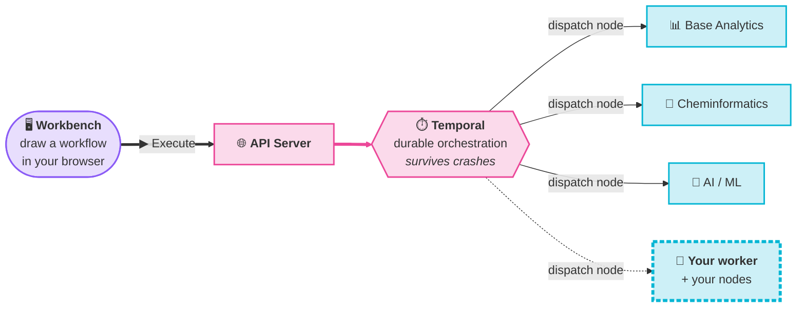

# Introduction

<Lead>

Project Continuum is an open-source, browser-native visual workflow platform — inspired by [KNIME](https://www.knime.com/), built for the cloud. You design workflows as a drag-and-drop graph of nodes, and the platform runs them durably: a crashed worker, a dead Kafka broker, or a dropped connection doesn't lose your progress.

</Lead>

<Badges>
  <Badge color="green">Apache 2.0</Badge>
  <Badge color="purple">Browser-native IDE</Badge>
  <Badge color="cyan">Powered by Temporal</Badge>
  <Badge color="amber">Parquet data passing</Badge>
</Badges>

No desktop install — the entire IDE runs in your browser.

## Why Continuum

<CardGrid cols={3}>
  <Card icon="🖥️" title="Browser-native canvas" color="purple">
    A full IDE experience (Eclipse Theia + React Flow) with zero install.
  </Card>
  <Card icon="🛡️" title="Crash-proof execution" color="pink">
    Powered by [Temporal](https://temporal.io), workflows survive process crashes, network failures, and restarts. Every step retries automatically.
  </Card>
  <Card icon="⚡" title="Real-time streaming" color="amber">
    Watch workflows execute step-by-step. Kafka streams events to your browser via MQTT over WebSockets. No polling, no refresh.
  </Card>
  <Card icon="🧱" title="Columnar data passing" color="green">
    Nodes exchange Apache Parquet tables, not JSON blobs. Fast, compressed, query-ready.
  </Card>
  <Card icon="🧩" title="Extensible by design" color="cyan">
    Add capabilities by deploying new worker services, not by modifying existing ones. Zero downtime, zero coupling.
  </Card>
  <Card icon="🔓" title="Open source" color="blue">
    Apache 2.0 licensed, from the workbench to the workers.
  </Card>
</CardGrid>

## How it fits together

A workflow is a directed graph of nodes. Each node runs as a Temporal activity dispatched to whichever feature worker registered it — base analytics, cheminformatics, AI/ML, or your own custom worker.

See [Architecture Overview](./architecture/overview.md) for the full execution path.

## Where to go next

<CardGrid cols={2}>
  <Card icon="🚀" title="Getting Started" color="purple" doc="getting-started/local-setup">
    Run the whole platform locally with one `docker compose up`.
  </Card>
  <Card icon="🏗️" title="Architecture" color="pink" doc="architecture/overview">
    How a workflow actually executes, end to end.
  </Card>
  <Card icon="🧰" title="Feature Nodes" color="green" doc="feature-nodes/base-analytics">
    What you can build with today.
  </Card>
  <Card icon="☸️" title="Deployment" color="cyan" doc="deployment/helm-charts">
    Running Continuum on Kubernetes.
  </Card>
</CardGrid>
